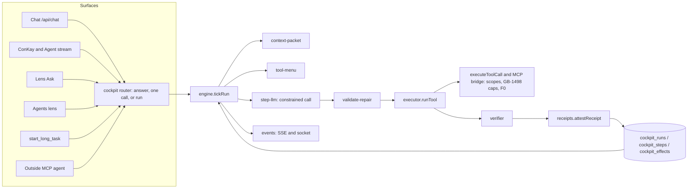
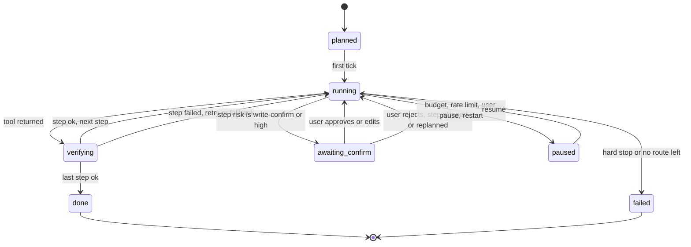

# Cockpit architecture: one execution core, built for a 2B

Ticket GB-1500. Read `AUDIT.md` first; this design answers its findings. `PLAN.md` turns it into tickets.

## 1. The idea

The model stops carrying the task. The server holds a **Run** made of **Steps**. For each step the server builds a small packet, offers at most 8 tools, takes one schema-constrained call, repairs it, runs it through the one tool executor, checks the result, signs a receipt, saves, and moves on. A step whose tool and arguments are already known never calls a model.

All new code lives in `server/lib/cockpit/` plus one route file and one migration. Nothing is moved out of `server/server.js`.



## 2. States



Run `status` is one of `planned | running | awaiting_confirm | verifying | paused | done | failed | cancelled`.
Step `status` is one of `pending | ready | running | awaiting_confirm | verifying | done | failed | skipped`.

A run never fails because one tool failed. It fails only on a hard stop, or when a required step has used every route in section 8 and the user has declined to help.

## 3. Types

These are the contracts. `PLAN.md` repeats the ones each ticket implements.

```js
/**
 * @typedef {"planned"|"running"|"awaiting_confirm"|"verifying"|"paused"|"done"|"failed"|"cancelled"} RunStatus
 * @typedef {"pending"|"ready"|"running"|"awaiting_confirm"|"verifying"|"done"|"failed"|"skipped"} StepStatus
 * @typedef {"read"|"compute"|"write"|"high"} Risk
 * @typedef {"chat"|"conkay"|"agent"|"ask"|"agents_lens"|"long_task"|"mcp"} Surface
 *
 * @typedef {Object} Run
 * @property {string} id                 "run_" + 16 hex chars
 * @property {string} userId
 * @property {Surface} surface
 * @property {string|null} chatSessionId chat thread this run reports into
 * @property {string|null} lensContext   lens id for Ask runs
 * @property {string} goal               the user's request, at most 2000 chars
 * @property {RunStatus} status
 * @property {string|null} statusReason  machine code, e.g. "rate_limited", "hard_stop:consent"
 * @property {number} planVersion        starts at 1, +1 on each replan
 * @property {number} cursor             seq of the step being worked on
 * @property {RunBudget} budget
 * @property {RunUsage} usage
 * @property {string} modelProfile       key into MODEL_PROFILES, e.g. "local-2b"
 * @property {number|null} resumeAt      epoch seconds; set when paused for a rate limit
 * @property {number} createdAt
 * @property {number} updatedAt
 * @property {number|null} finishedAt
 *
 * @typedef {Object} RunBudget
 * @property {number} maxSteps           default 60, hard 200
 * @property {number} maxToolCalls       default 120
 * @property {number} maxModelCalls      default 150
 * @property {number} maxTokensIn        default 400000
 * @property {number} wallMs             default 3600000
 * @property {number} stepWallMs         default 120000
 *
 * @typedef {Object} RunUsage
 * @property {number} toolCalls
 * @property {number} modelCalls
 * @property {number} tokensIn
 * @property {number} tokensOut
 * @property {number} humanInterventions
 *
 * @typedef {Object} Step
 * @property {string} id                 "stp_" + 16 hex chars
 * @property {string} runId
 * @property {number} seq                1-based order within the plan version
 * @property {number} planVersion
 * @property {string} goal               one sentence, at most 200 chars, shown to the user
 * @property {string|null} tool          tool id; null means the model picks from the menu
 * @property {Object|null} args          known arguments; may contain {"$ref":"stp_x.result.path"}
 * @property {Expect[]} expects
 * @property {string[]} dependsOn        step ids
 * @property {boolean} required          false means a failure skips the step
 * @property {StepStatus} status
 * @property {number} attempts
 * @property {string|null} resultRef     "inline" or "dtu:<id>" or "media:<id>"
 * @property {Object|null} resultSummary typed summary, at most 1200 chars serialized
 * @property {string|null} receiptId
 * @property {string|null} idempotencyKey
 * @property {string|null} errorClass    last FailureClass
 * @property {string|null} fallbackTool
 *
 * @typedef {Object} Expect
 * @property {"ok"|"schema"|"range"|"nonempty"|"numeric_trace"|"receipt"|"not_stub"|"judge"} kind
 * @property {string} [path]             dotted path into the result
 * @property {Object} [schema]           for kind "schema"
 * @property {number} [min]
 * @property {number} [max]
 * @property {string} [claim]            for kind "judge"
 *
 * @typedef {Object} ToolSpec
 * @property {string} id                 agent tool name, or "lens:<domain>.<action>"
 * @property {string} title              plain words for the user, e.g. "Size the beam"
 * @property {string} description        at most 160 chars, for the model
 * @property {Object} inputSchema        JSON Schema, strict subset (section 6)
 * @property {Object|null} outputSchema
 * @property {Risk} risk
 * @property {boolean} idempotent        true when a repeat call cannot double-write
 * @property {string[]} aliases
 * @property {string[]} fallbacks        tool ids to try next
 * @property {number} timeoutMs
 * @property {string[]} requiresScopes   bridge scopes, e.g. ["mcp:lens:compute"]
 *
 * @typedef {Object} ContextPacket
 * @property {string} presetId           DHTP preset id or "cockpit.step"
 * @property {string} goal               the step goal
 * @property {string} runGoal            the run goal, at most 300 chars
 * @property {Evidence[]} evidence       at most 8
 * @property {PriorResult[]} prior       at most 6, newest first, values the step depends on
 * @property {string[]} constraints      at most 6 lines
 * @property {string} doneWhen           one sentence
 * @property {MenuItem[]} menu           at most 8
 * @property {number} tokenBudgetIn      target 2500
 * @property {number} estTokens          chars / 4
 *
 * @typedef {Object} Evidence
 * @property {string} id                 DTU id or "step:<id>"
 * @property {string} title
 * @property {string} snippet            at most 240 chars
 * @property {"dtu"|"step"|"lens"|"memory"} source
 *
 * @typedef {Object} PriorResult
 * @property {string} stepId
 * @property {string} goal
 * @property {Object} values             flat key to scalar map, at most 12 keys
 *
 * @typedef {Object} MenuItem
 * @property {string} id
 * @property {string} description
 * @property {Object} inputSchema
 *
 * @typedef {Object} ToolCall
 * @property {string} tool               one of the menu ids, or "ask_user", or "done"
 * @property {Object} args
 * @property {string} why                at most 120 chars
 *
 * @typedef {Object} StepResult
 * @property {boolean} ok
 * @property {string} tool
 * @property {Object|null} result
 * @property {FailureClass|null} errorClass
 * @property {string|null} error         plain text, no tool names
 * @property {string|null} retryHint
 * @property {Object[]} artifacts
 * @property {number} latencyMs
 * @property {string|null} provider
 * @property {string|null} model
 *
 * @typedef {Object} RepairAttempt
 * @property {number} n                  1-based
 * @property {"alias"|"fuzzy_name"|"key_normalize"|"coerce"|"default"|"reask"|"fallback_tool"|"slot_change"|"ask_user"} kind
 * @property {string} before             JSON of the call before
 * @property {string} after              JSON of the call after
 * @property {string[]} errors           validator errors that triggered it
 * @property {boolean} fixed
 *
 * @typedef {Object} Receipt
 * @property {"cockpit.step.v1"} kind
 * @property {string} runId
 * @property {string} stepId
 * @property {number} seq
 * @property {string} tool
 * @property {string} argsHash           sha256 of canonical JSON of args
 * @property {string} resultHash         sha256 of canonical JSON of result
 * @property {boolean} ok
 * @property {Expect[]} checks           each with a pass boolean added
 * @property {string|null} idempotencyKey
 * @property {string|null} provider
 * @property {string|null} model
 * @property {string} issuedAt           added by attestReceipt
 * @property {Object} signature          added by attestReceipt
 *
 * @typedef {"bad_args"|"unknown_tool"|"unsupported_input"|"not_found"|"external"|"disabled_tool"
 *   |"tool_error"|"scope_denied"|"rate_limited"|"timeout"|"model_empty"|"model_malformed"
 *   |"verify_failed"|"fake_success"|"looped"|"hard_stop"} FailureClass
 */
```

## 4. Persistence

Three new tables in migration 501 (the highest on main is 500; confirm at build time). Reused as they are: `agent_marathon_tool_log` (dispatch write-ahead log), `agent_action_log` (action memory and failure counts), `chat_sessions` (thread link).

Why not put runs in the existing tables:

- `agent_marathon_sessions` has a `CHECK` on `status` that lacks `awaiting_confirm` and `verifying`, and the long-task pump (`findDueLongTasks`) would tick a cockpit row with the old loop.
- `agent_thread_checkpoints` stores `messages_json`, the model-carried history this design removes.
- `mission_tasks` is operator-scoped and ticks through Dila templates.

```sql
CREATE TABLE IF NOT EXISTS cockpit_runs (
  id TEXT PRIMARY KEY,
  user_id TEXT NOT NULL,
  surface TEXT NOT NULL,
  chat_session_id TEXT,
  lens_context TEXT,
  goal TEXT NOT NULL,
  status TEXT NOT NULL DEFAULT 'planned',
  status_reason TEXT,
  plan_version INTEGER NOT NULL DEFAULT 1,
  cursor INTEGER NOT NULL DEFAULT 1,
  budget_json TEXT NOT NULL DEFAULT '{}',
  usage_json TEXT NOT NULL DEFAULT '{}',
  model_profile TEXT NOT NULL DEFAULT 'local-2b',
  resume_at INTEGER,
  lease_owner TEXT,
  lease_until INTEGER,
  created_at INTEGER NOT NULL DEFAULT (unixepoch()),
  updated_at INTEGER NOT NULL DEFAULT (unixepoch()),
  finished_at INTEGER
);
CREATE INDEX IF NOT EXISTS idx_cockpit_runs_user ON cockpit_runs(user_id, created_at DESC);
CREATE INDEX IF NOT EXISTS idx_cockpit_runs_due ON cockpit_runs(status, resume_at);

CREATE TABLE IF NOT EXISTS cockpit_steps (
  id TEXT PRIMARY KEY,
  run_id TEXT NOT NULL,
  seq INTEGER NOT NULL,
  plan_version INTEGER NOT NULL DEFAULT 1,
  goal TEXT NOT NULL,
  tool TEXT,
  args_json TEXT,
  expects_json TEXT NOT NULL DEFAULT '[]',
  depends_on_json TEXT NOT NULL DEFAULT '[]',
  required INTEGER NOT NULL DEFAULT 1,
  status TEXT NOT NULL DEFAULT 'pending',
  attempts INTEGER NOT NULL DEFAULT 0,
  result_ref TEXT,
  result_json TEXT,
  result_summary_json TEXT,
  receipt_json TEXT,
  idempotency_key TEXT,
  error_class TEXT,
  error_text TEXT,
  repairs_json TEXT NOT NULL DEFAULT '[]',
  fallback_tool TEXT,
  started_at INTEGER,
  finished_at INTEGER,
  UNIQUE (run_id, plan_version, seq)
);
CREATE INDEX IF NOT EXISTS idx_cockpit_steps_run ON cockpit_steps(run_id, plan_version, seq);

CREATE TABLE IF NOT EXISTS cockpit_effects (
  idempotency_key TEXT PRIMARY KEY,
  run_id TEXT NOT NULL,
  step_id TEXT NOT NULL,
  tool TEXT NOT NULL,
  args_hash TEXT NOT NULL,
  status TEXT NOT NULL DEFAULT 'claimed',   -- claimed | completed | failed | unknown
  result_json TEXT,
  created_at INTEGER NOT NULL DEFAULT (unixepoch()),
  completed_at INTEGER
);
```

No `CHECK` constraints on status columns: the allowed values are enforced in `run-store.js`, so a later state needs no table rebuild. `result_json` is capped at 16,384 bytes; anything larger is stored as a DTU or media and referenced by `result_ref`.

## 5. Replay and resume

Temporal's split, applied here:

- **Orchestration is deterministic.** `engine.tickRun` decides the next action only from rows in the three tables. It never reads the clock except through `deps.now`, never uses randomness, and never asks a model what to do next when the plan already says.
- **Activities are not deterministic** and run once: a model call, a tool call. Their outcome is written to `cockpit_steps` before the engine moves the cursor (LangGraph's `sync` durability).

Resume after a restart, deploy, or lost socket:

1. `pump.findDueRuns` selects runs with status `running` or `verifying` whose `lease_until` is in the past, and runs with status `paused` whose `resume_at` is in the past.
2. For the step at `cursor`:
   - `done` or `skipped`: advance.
   - `running`, with a `claimed` row in `cockpit_effects`: the process died mid-call. If the tool is `idempotent`, call again with the same key. If the tool spec has a probe (a read that shows whether the write landed), run it. Otherwise set the effect to `unknown` and move the step to `awaiting_confirm` with the card "This step may already have happened. Check and choose: mark done, or run again."
   - `running`, with no effect row: nothing was dispatched. Run the step again.
   - `verifying`: re-run the verifier on the stored result. It is pure.
3. A model call that was in flight is simply made again. It had no side effect.

A lease (`lease_owner`, `lease_until`, 90 s, renewed each step) stops two workers from ticking one run.

## 6. The call schema

One call per model turn. The schema is built per step from the menu, so the tool name is an enum and the arguments are a per-tool object.

```json
{
  "type": "object",
  "additionalProperties": false,
  "required": ["tool", "args", "why"],
  "properties": {
    "tool": { "type": "string", "enum": ["physics.power", "run_recipe", "ask_user", "done"] },
    "args": { "type": "object" },
    "why":  { "type": "string", "maxLength": 120 }
  }
}
```

Hosted strict-tool models get the menu as native tools and return one call. Local models cannot use the combined shape above with typed `args`, because llama.cpp cannot mix `properties` with `oneOf` and silently skips what it does not support. They decode in two phases:

1. **Pick.** `format` is `{tool: enum, why: string}` only.
2. **Fill.** `format` is the chosen tool's own `inputSchema`.

When the step declares its tool, phase 1 is skipped. When the step also declares all arguments, no model is called.

The strict subset allowed in a `ToolSpec.inputSchema`: `type`, `properties`, `required`, `enum`, `items`, `minimum`/`maximum` on integers, `additionalProperties: false`, `description`. No `oneOf`, `anyOf`, `$ref`, `pattern`, or `format`. Number ranges on non-integers are checked by the validator, not the grammar.

Per provider:

| Model profile | Phase 1 and 2 transport | Fallback |
|---|---|---|
| `local-2b`, `local-9b`, `local-30b` (Ollama) | `format: <schema>`, `temperature: 0`, `think: false` | marker `[TOOL_CALL: …]` parsed by `parseToolCalls` |
| `gpt-oss-cloud` (Ollama cloud tags) | `format: <schema>`; reasoning level from `ollama-request-guard.js` since `think:false` is ignored | marker |
| BYO OpenAI-compatible | `tools` with `strict: true`, `tool_choice: "required"`, `parallel_tool_calls: false` | marker |
| BYO Anthropic | `tools` with `strict: true`, `tool_choice: {type:"any", disable_parallel_tool_use:true}` | marker |
| anything else | marker | none |

`MODEL_PROFILES` in `model-caps.js` holds, per profile: `nativeTools`, `jsonSchemaFormat`, `contextTokens`, `packetBudgetIn`, `maxMenu`, `reasoningQuirk`, `slot`.

## 7. Validation and repair

Order, stopping at the first that yields a valid call:

1. **Alias**: `ToolSpec.aliases`, then the existing `normalizeToolCall`.
2. **Fuzzy name**: `closestNames(wanted, menuIds, 1)` from `chat-agent.js:608`, accepted only when the edit distance is at most 2 or one name contains the other.
3. **Key normalize**: case, snake/camel, and the alias table from `normalizeLensActionParams`.
4. **Coerce**: `"2"` to `2`, `"12 mm"` to `0.012` where the schema says number and the key has a unit hint, `"true"` to `true`, a single value to a one-item array.
5. **Default**: fill a missing required key from `MACRO_INPUT_HINTS`, then from a `PriorResult` value with the same key name.
6. **Re-ask** (once per step attempt): send back only the validator errors and the allowed values (enum members, valid keys, supported parts), with the same schema.
7. **Fallback tool**: `ToolSpec.fallbacks[0]`, or a matching recipe.
8. **Ask the user**: one plain question; the run moves to `awaiting_confirm`.

Every attempt is appended to `cockpit_steps.repairs_json` as a `RepairAttempt`.

## 8. Retry and fallback by failure class

| Class | Action 1 | Action 2 | Action 3 | Then |
|---|---|---|---|---|
| `bad_args` | repair (section 7, steps 1-5) | re-ask | fallback tool | ask user |
| `unknown_tool` | fuzzy name | re-ask with menu | fallback tool | skip if not required |
| `unsupported_input` | fallback tool | recipe | ask user | skip if not required |
| `not_found` | re-resolve the id from prior results or a search step | re-ask | ask user | skip if not required |
| `external` | retry after 1 s | retry after 2 s | fallback tool | skip if not required |
| `disabled_tool` | fallback tool | ask user | n/a | skip if not required |
| `tool_error` | retry once after 1 s | fallback tool | ask user | fail step |
| `timeout` | retry once with double the wall time | slot change | fallback tool | ask user |
| `model_empty`, `model_malformed` | retry same slot | slot change (`utility` to `conscious`, then platform provider if not pinned local) | marker transport | ask user |
| `verify_failed`, `fake_success` | re-run with a re-ask naming the failed check | fallback tool | ask user | fail step |
| `rate_limited` | pause the run until the window opens | n/a | n/a | resume |
| `scope_denied` | none | n/a | n/a | ask user (it is their permission) |
| `looped` | replan from the current step | ask user | n/a | fail step |
| `hard_stop` | none | n/a | n/a | run `failed`, `status_reason` names the cause |

Backoff follows Temporal's defaults: 1 s, coefficient 2. At most 4 attempts per step.
`hard_stop` is exactly today's `HARD_ERROR_RE` (`lib/chat/tool-turn-reply.js:24`): governance, authorization, insufficient funds, quota, consent.
A failed non-required step is `skipped` and the final report lists it. A failed required step asks the user once before the run fails.

## 9. Verifier

Per step, in order, all in code unless noted:

1. `ok`: the executor returned ok.
2. `schema`: result matches `ToolSpec.outputSchema` or the step's `expects` schema.
3. `range` and `nonempty`: on the named path.
4. `not_stub`: the result text has no stub wording (`mock`, `placeholder`, `not implemented`, `coming soon`, `lorem`), and a write returned an id. Wording list starts from the tool sweep's fake-success rule.
5. `numeric_trace`: `guardNumericTrace` from `lib/chat/numeric-trace.js:68` on any text the step produced.
6. `receipt`: tools that return their own receipt (recipes, ConKay) pass `verifyAttestation` or `verifyReceipt`.
7. `judge`: only when the step lists it. Calls `verifyClaim` (`lib/reason-verify.js:59`) with `requesterId` set, so private DTUs stay private.

## 10. Idempotency

`idempotencyKey = sha256(run.id + "|" + step.id + "|" + tool + "|" + canonicalJson(args))`, using `canonicalJson` from `lib/receipts/attest.js:60`.

For every step whose risk is not `read`:

1. `INSERT` into `cockpit_effects` with status `claimed`. A primary-key conflict means the key was used: return the stored result if `completed`, or follow section 5 if `claimed`.
2. Write the dispatch row with `recordToolDispatch` (`lib/marathon-tick-durability.js:79`).
3. Call the tool, passing `idempotency_key` and setting the F0 envelope trace id to the key, so `gates/idempotency.js` sees a retry as the same trace.
4. Update the effect to `completed` or `failed`, and the dispatch row with `recordToolOutcome`.

Retries after `bad_args` change the arguments and therefore the key, which is correct: a call that failed validation wrote nothing.

## 11. Confirmation

Risk comes from, in order: the capability registry, the lens action spec, the cockpit tool catalogue, `classifyLensActionRisk`. The bridge decides scopes; the cockpit decides whether to pause.

| Risk | Pause for the user | Counts toward GB-1498 heavy cap |
|---|---|---|
| read, compute | no | no |
| write | once per run for the first write of each tool, unless the user said "don't ask again for this run" | yes |
| high (pay, publish, delete, transfer, deploy) | always, every time | yes |

The card shows the step goal, what will change, and the argument values in plain words. The user can approve, edit a value, or reject. Approval is stored as `{stepId, argsHash, userId, at}`; the executor passes `approval: true` to the bridge only when a stored approval matches the step's current `argsHash`. The executor strips `approval`, `approval_token`, `dry_run` and `idempotency_key` from model-written arguments before anything else.

## 12. Progress and receipts for the user

Events, sent over the existing SSE writer (`ctx.chatProgress`) and socket:

```json
{ "type": "cockpit:run",  "runId": "run_…", "status": "running", "done": 6, "total": 31 }
{ "type": "cockpit:step", "runId": "run_…", "seq": 7, "total": 31, "status": "done",
  "label": "Sized the beam", "receiptId": "stp_…" }
{ "type": "cockpit:confirm", "runId": "run_…", "stepId": "stp_…", "label": "Save the design",
  "changes": ["Creates 1 design in Engineering"], "args": [{"name":"Title","value":"Garage beam"}] }
```

`label` is `ToolSpec.title` or the step goal. Tool ids never appear in user-facing text; `scrubUserFacingToolNames` is applied to every label and error.

## 13. Budgets

| Budget | Default | Env | On reaching it |
|---|---|---|---|
| steps per run | 60 | `CONCORD_COCKPIT_MAX_STEPS` (hard 200) | pause, ask to continue |
| tool calls per run | 120 | `CONCORD_COCKPIT_MAX_TOOL_CALLS` | pause |
| model calls per run | 150 | `CONCORD_COCKPIT_MAX_MODEL_CALLS` | pause |
| tokens in per step | 2500 for `local-2b` | from the model profile | packet is trimmed, never the schema |
| step wall time | 120 s | `CONCORD_COCKPIT_STEP_WALL_MS` | `timeout` class |
| run wall time | 1 h | `CONCORD_COCKPIT_RUN_WALL_MS` | pause |
| account calls | 100/h, 20 heavy/h | GB-1498's `MCP_BRIDGE_RATE_LIMIT_PER_HOUR`, `MCP_BRIDGE_HEAVY_RATE_LIMIT_PER_HOUR` | pause with `resume_at` |
| concurrent runs per user | 2 | `CONCORD_COCKPIT_MAX_ACTIVE` | refuse the start with a plain message |

The existing `CONCORD_AGENT_*` knobs keep governing the old loops. A run in the foreground of a chat turn works for at most the chat turn's deadline, then continues from the pump; the user sees the progress card and is not blocked.

Event loop: one step per tick, `await` between steps, every tool call inside `withJob("cockpit:<tool>")` from `lib/loop-job-tracker.js`, and the pump skips a cycle when `getPressureStrikes()` from `lib/request-admission.js` is above zero.

## 14. Routing in

`cockpit/router.js#decide(message, ctx)` returns one of:

- `answer`: no tool needed. Existing chat path.
- `single`: one tool. A one-step run, executed in the foreground. Same validation, repair, retry, verify and receipt.
- `run`: more than one step, or `isLongTaskAsk`, or the planner returns more than one step.
- `resume`: the user's message answers a waiting run.

Affirmations no longer depend on a regex over the last reply. If the thread has a run in `awaiting_confirm`, then `isBareAffirmation` approves it, "no"/"cancel"/"stop" rejects it, and anything else is treated as an edit or a new request. If no run is waiting, today's `chatAgentRoute` behaviour is unchanged. "What happened?" reads the last run's failed and skipped steps from the table.

Lens Ask sends `lensContext`. The run's first evidence items are the lens's own description (from `lens-manifest`) and, where the lens registers one, a `context` read action. Thread identity follows Muse's rule from `RCA-ask-silent`: an Ask reuses a thread filed under that lens or starts one.

## 15. What fixes what

| Problem | Component | Ticket |
|---|---|---|
| Oct 19 #1: loop ends on one failure | retry policy, engine | CKPT-05, CKPT-09 |
| Oct 19 #2: "yes run it" | `awaiting_confirm` state, router | CKPT-13, CKPT-16 |
| Oct 19 #3: no 3D/CAD continuation | plan templates, fallbacks | CKPT-10 |
| Oct 19 #4: invented compute keys | constrained call, repair | CKPT-03, CKPT-04 |
| Oct 19 #5: disabled tool advertised | tool menu from runnable specs | CKPT-02, CKPT-06 |
| Oct 19 #6: stale DTU id | `not_found` policy, prior results | CKPT-05, CKPT-07 |
| Oct 19 #7: claimed a tool it never ran | server-owned steps, verifier | CKPT-09, CKPT-11 |
| Oct 19 #8: embeddings probe | already fixed | none |
| FIX-crisis-ops-001 | one executor on GB-1498 scopes | CKPT-14 (needs GB-1498) |
| FIX-meditation-002, FIX-wellness-004, FIX-reasoning-002 (agent parts) | reply field contract | CKPT-19 |
| FIX-agents-010 | Agents lens on the core | CKPT-19 |
| FIX-chat-001 | run and reply events appended to the open thread | CKPT-17 |
| FIX-chat-014 | Thread Summarize as a one-step run with a visible result | CKPT-19 |
| FIX-quests-005, FIX-world-005 | Ask thread binding | CKPT-18 (on Muse's fix) |
| FIX-analytics-005, FIX-lattice-004, FIX-narrative-walk-006, FIX-frontier-005, FIX-concord-link-frontier-009, FIX-government-023, FIX-healthcare-005 | lens context evidence | CKPT-18 |
| FIX-forecast-001 | slot extraction through the constrained call | CKPT-18 |
| FIX-goddess-001, FIX-lfg-001, FIX-tick-005, FIX-inheritance-011 | server deadline, error card, diagnosis procedure | CKPT-18 |
| Self-approval of high-risk actions | executor strips model-written approval | CKPT-13 |
| Dead `pickTools` | repaired imports | CKPT-06 |
